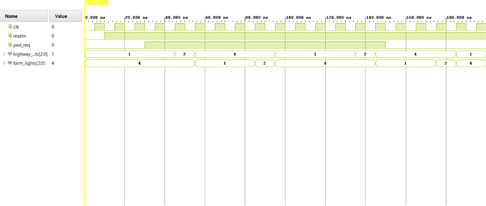

# 🚦 Smart FSM Traffic Light Controller with Pedestrian Detection

An industrial-grade, synchronous sequential digital network modeling an intelligent intersection controller between a **Main Highway (HW)** and a secondary **Farm-Road (FM)**. Designed in **Verilog RTL** and fully verified using **Xilinx Vivado**, this microarchitecture leverages a high-reliability **3-Always Block Finite State Machine (FSM)** topology integrated with an automated time-counter reset strategy and asynchronous pedestrian crosswalk sensor detection.

---

## 🏗️ Hardware Architecture & Interface

The module monitors a 4-bit synchronous clock counter and an external pedestrian trigger (`ped_req`) to safely alternate signal phases without collision states.

### Hardware Interface (I/O Signals)

| Signal Name | Direction | Bit Width | Description |
| :--- | :---: | :---: | :--- |
| `clk` | Input | 1-bit | Primary System Clock Signal |
| `resetn` | Input | 1-bit | Active-Low Synchronous/Asynchronous Reset |
| `ped_req` | Input | 1-bit | External Pedestrian Crosswalk Sensor Indicator |
| `highway_lights` | Output | 2-bit | Encoded Signal Output for Main Highway (Green/Yellow/Red) |
| `farm_lights` | Output | 2-bit | Encoded Signal Output for Secondary Farm-Road (Green/Yellow/Red) |

### System Module Logic Block Diagram
```text
                  +---------------------------------------+

                  |       TRAFFIC LIGHT CONTROLLER        |
                  |                                       |
   clk ---------->|  +------------+       +------------+  |
   resetn ------->|  |            |       |            |  |---> highway_lights [1:0]
   ped_req ------>|  |  FSM Core  |------>| Output Dec |  |---> farm_lights [1:0]

                  |  |  (State)   |       |  (Lights)  |  |
                  |  +------------+       +------------+  |
                  |        ^                     |        |
                  |        |                     v        |
                  |  +---------------------------------+  |
                  |  |  Synchronous Transition Counter |  |
                  |  +---------------------------------+  |
                  +---------------------------------------+
```

---

## 🗺️ Finite State Machine (FSM) State Diagram

The algorithmic state transitions and routing conditions are structured as follows:

```text
       +---------------------------------------------------------+

       |                                                         |
       v                                                         |
+-------------------+      count >= 3 && ped_req     +-------------------+

|   S0_HW_GREEN     |------------------------------->|   S1_HW_YELLOW    |
|   (HW:G / FM:R)   |                                |   (HW:Y / FM:R)   |
+-------------------+                                +-------------------+
       ^                                                       |

       |                                                       | count >= 0
       | count >= 0                                            v
+-------------------+                                +-------------------+

|   S3_FM_YELLOW    |                                |   S2_FM_GREEN     |
|   (HW:R / FM:Y)   |<-------------------------------|   (HW:R / FM:G)   |
+-------------------+           count >= 2           +-------------------+
```

### Transition & Timing Parameters

| Current State | Highway Signal | Farm-Road Signal | Next State Target | Hardware Trigger Conditions |
| :--- | :---: | :---: | :--- | :--- |
| 🟢 **`S0_HW_GREEN`** | **GREEN** | RED | `S1_HW_YELLOW` | `if (count >= 4'd3 && ped_req)` |
| 🟡 **`S1_HW_YELLOW`** | **YELLOW** | RED | `S2_FM_GREEN` | `if (count >= 4'd0)` (Immediate) |
| 🟢 **`S2_FM_GREEN`** | RED | **GREEN** | `S3_FM_YELLOW` | `if (count >= 4'd2)` |
| 🟡 **`S3_FM_YELLOW`** | RED | **YELLOW** | `S0_HW_GREEN` | `if (count >= 4'd0)` (Immediate) |

*To ensure absolute timing predictability, the internal state timer register flushes back to zero the exact clock edge an FSM transition condition is verified (`state != next_state`).*

---

## 📂 Repository File Tree

* 📦 `TrafficLightController.srcs/` — [Core RTL Design Source & Verification Testbenches](./TrafficLightController.srcs)
* ⚙️ `TrafficLightController.sim/` — Behavioral Simulation Configuration Snapshot Engines
* 🛠️ `TrafficLightController.xpr` — Primary Xilinx Vivado Project Link
* 🛡️ `.gitignore` — Automated Build Tool Logs and Memory Dump Filters

---

## 🚀 Verification & Simulation Strategy

The design has been strictly validated via RTL Behavioral Simulation snapshots within the **Xilinx Vivado Simulator (XSIM)**. 

## Simulation Output Waveform


### Waveform Inspection Guidelines
1. Launch Xilinx Vivado and open the tracking project link (`TrafficLightController.xpr`).
2. Navigate to the `Simulation Sources` folder structure in the Hierarchy viewer.
3. Right-click your verification file suite and click **Set as Top**.
4. Click **Run Simulation** -> **Run Behavioral Simulation**.
5. Verify the following parameters inside your waveform panel:
   * The counter register clears instantly on state boundaries, eliminating transition race conditions.
   * `highway_lights` and `farm_lights` safely preserve hardware isolation (never active green at the same time).
